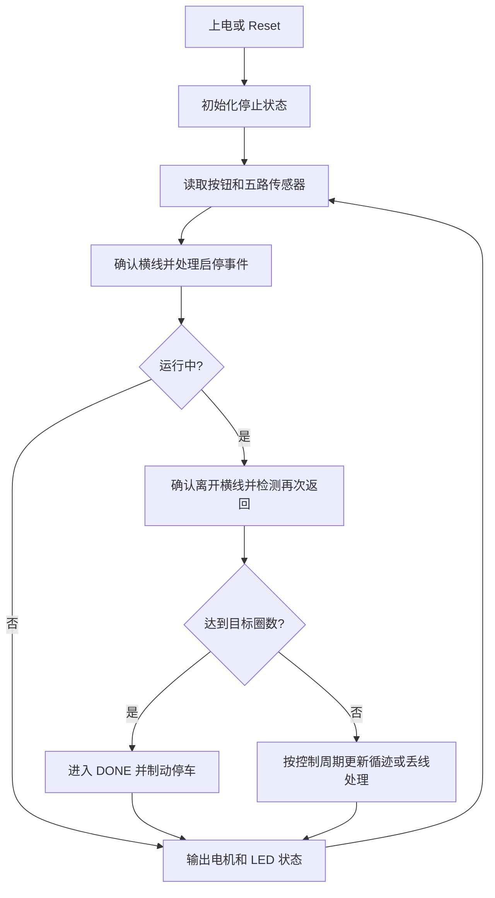

# 两轮后驱黑线循迹小车

本工程使用 **STM32F103C8T6 + TB6612FNG + 5 路数字循迹传感器**，驱动左右两个后轮，通过两轮速度差转向，车头安装循迹传感器和支撑轮。

当前实现为：**从起终点横向黑线启动，沿闭环黑线循迹，返回横线后计圈，默认完成一圈自动停车**。仍可用按键手动停止，Reset 后保持停止。起终点识别直接复用 PA0～PA4 的五路循迹传感器。

## 代码使用的硬件

| 硬件 | 数量 | 代码如何使用 |
| --- | --- | --- |
| STM32F103C8T6 主控板 | 1 | 运行控制程序，读取 GPIO，产生双路 PWM；使用板上 8 MHz 外部晶振，系统时钟配置为 72 MHz |
| TB6612FNG 双路直流电机驱动模块 | 1 | A 通道驱动左后轮，B 通道驱动右后轮；分别接收 PWM 和方向信号，STBY 控制使能 |
| 直流减速电机及后轮 | 2 组 | 左右轮独立驱动，通过不同占空比实现差速转向 |
| 数字红外循迹传感器 | 5 路 | 读取数字输出 DO，判断各位置是黑线还是白底；可使用一个具有五路独立 DO 的阵列模块 |
| 瞬时按键 | 1 | 同一个按键切换启动和停止，按下接地 |
| PC13 板载 LED | 1 | 显示停止、运行、丢线及起点无效状态 |
| 主控板 Reset 按键 | 1 | 通过 NRST 复位主控；不是代码轮询的启停按键 |
| 电机电源与主控电源 | 按实际模块配置 | 给电机驱动器和控制电路供电，所有模块共地 |
| SWD 下载器 | 1，下载时使用 | 通过 PA13/PA14 下载和调试程序 |

车头的万向支撑轮属于机械支撑，不由代码控制。五路传感器应位于后轮前方，按从车头向前看的左外、左、中、右、右外顺序安装。本程序没有调用传感器的模拟输出，也没有读取电机编码器或控制转向舵机。

## 操作与实际行为

1. 上电或复位后，小车保持停止，PC13 板载 LED 熄灭。
2. 将五路传感器同时放在横向起终点黑线上，按一下启停按钮，小车开始行驶，LED 常亮。若未检测到起点横线，保持停车并闪灯提示。
3. 小车离开起点、完成一圈并再次识别到横线后，自动制动停车，LED 熄灭。运行中也可再次按同一按钮手动停车；重新启动前需放回起点横线。长按只触发一次。
4. 按 Reset，程序重新初始化，回到停止状态。复位时即使一直按住启停按钮，也需要先松开再按下才能启动。
5. 短暂丢线时，小车沿最后看到黑线的方向低速找线；首次没有方向记录时低速直行。持续丢线约 600 ms 后停车，LED 闪烁。放回起终点横线并重新按按钮后开始新任务。

横向起终点线应覆盖五路传感器，让检测结果为全黑 `11111`。普通循迹线应主要由中间一到两路识别，其他位置不能出现相同的全黑图案。程序面向无岔路、只有一条起终点横线的闭环轨道。目标圈数由 `CAR_TARGET_LAPS` 配置，默认 1 圈；圈数统计可在调试器中查看 `car.completed_laps`。

## 默认接线

以下引脚均已由 `chapter.c` 初始化；在现有工程中可以直接编译，不需要先手动增加 CubeMX 外设配置。

| 设备信号 | STM32 引脚 | GPIO 模式或外设 | 用途与默认电平 |
| --- | --- | --- | --- |
| 最左侧循迹传感器 DO | PA0 | 上拉输入 | 左外侧检测，黑线为低电平 |
| 左侧循迹传感器 DO | PA1 | 上拉输入 | 左侧检测，黑线为低电平 |
| 中间循迹传感器 DO | PA2 | 上拉输入 | 中央检测，黑线为低电平 |
| 右侧循迹传感器 DO | PA3 | 上拉输入 | 右侧检测，黑线为低电平 |
| 最右侧循迹传感器 DO | PA4 | 上拉输入 | 右外侧检测，黑线为低电平 |
| TB6612 PWMA | PA6 / TIM3_CH1 | 复用推挽输出 | 左后轮 20 kHz PWM |
| TB6612 AIN1 | PB0 | 推挽输出 | 左后轮前进时默认高电平 |
| TB6612 AIN2 | PB1 | 推挽输出 | 左后轮前进时默认低电平 |
| TB6612 PWMB | PA7 / TIM3_CH2 | 复用推挽输出 | 右后轮 20 kHz PWM |
| TB6612 BIN1 | PB10 | 推挽输出 | 右后轮前进时默认高电平 |
| TB6612 BIN2 | PB11 | 推挽输出 | 右后轮前进时默认低电平 |
| TB6612 STBY | PB12 | 推挽输出 | 初始化时低，电机控制初始化完成后高 |
| 启停按钮 | PB5 与 GND 之间 | 上拉输入 | 松开为高电平，按下为低电平 |
| 板载 LED | PC13 | 推挽输出 | 低电平点亮 |
| SWDIO / SWCLK | PA13 / PA14 | SWD 调试接口 | 保留下载调试接口 |
| 板载外部晶振 | PD0 / PD1 | HSE 振荡器接口 | 使用板上已连接的 8 MHz 晶振 |
| 主控板 Reset 按键 | NRST | 硬件复位输入 | 使用板上复位电路，不连接 PB5 |

左后轮接 TB6612 的 AO1/AO2，右后轮接 BO1/BO2。TB6612 的逻辑电源 VCC 接 3.3 V，电机电源 VM 使用与电机和驱动器匹配的电源；STM32、传感器、电机驱动器和电机电源必须共地。电机由驱动器供电。

五路传感器从车头向前看依次为左外、左、中、右、右外，接模块的数字输出 DO。传感器输出必须与 STM32 的 3.3 V 输入电平兼容；若模块使用 5 V 供电且输出 5 V，需做电平转换。默认黑线输出低电平，白底输出高电平。安装高度、黑线宽度和传感器间距应让普通直线上主要由中间一到两路检测到黑线。

四脚轻触按键应使用按下后才接通的两组触点，一组接 PB5、一组接 GND。PA13/PA14 用于调试；TIM3 的 PWM 使用默认映射 PA6/PA7。修改 PWM 引脚时，需要同时修改定时器通道和重映射配置；只改引脚宏不能自动迁移 PWM。

## 代码分别实现什么任务

| 文件或函数 | 实现的任务 |
| --- | --- |
| `Core/Src/main.c` | 已有入口：初始化 HAL、72 MHz 系统时钟，然后调用 `chapter_main()` |
| `Core/Src/chapter.c` → `HardwareInit()` | 初始化传感器、按钮、方向与使能引脚；配置 TIM3 双通道 20 kHz PWM |
| `chapter.c` → `ReadBlackMask()` | 同时读取五路传感器，转换为“1 表示黑线”的五位数据 |
| `chapter.c` → `MotorApply()` | 将左右占空比转换为硬件 PWM，设置前进方向；占空比为零的车轮进入制动 |
| `chapter.c` → `chapter_main()` | 每约 1 ms 读取输入、更新控制、驱动电机并显示 LED 状态 |
| `Core/Src/car_control.c` → `ButtonPressedEvent()` | 25 ms 非阻塞按键消抖，防止长按反复切换 |
| `car_control.c` → `CarControl_Init()` | 初始化停止状态，确保上电或 Reset 后不会自动运行 |
| `car_control.c` → `CarControl_Update()` | 启停与起点验证、横线计圈、完成停车；每 5 ms 更新循迹与丢线处理 |
| `car_control.c` → `MarkerEntered()` / `UpdateLaps()` | 全黑消抖、稳定离开横线确认、每次返回只计一圈 |
| `Core/Inc/car_control.h` | 定义停止、运行、丢线、完成和起点无效状态，保存圈数和识别过程 |
| `Core/Inc/car_config.h` | 集中配置引脚、黑线电平、电机方向、占空比、转向系数与消抖/丢线时间 |
| `CMakeLists.txt` | 将新代码加入编译，并生成 ELF、HEX、BIN 固件 |
| `tests/test_car_control.c` | 模拟按键、传感器与时间，检查单圈/多圈停车、横线抖动、错误计圈和计时回绕 |

## 代码如何实现行驶任务

### 1. 初始化并保持停止

程序调用顺序如下：

```text
main()
  → HAL_Init()、SystemClock_Config()、MX_GPIO_Init()
  → chapter_main()
      → HardwareInit()：配置输入、方向、使能、LED、TIM3 PWM
      → CarControl_Init()：状态设为 CAR_STOPPED，左右占空比设为 0
      → 循环读取输入、计算控制、输出电机和 LED 状态
```

`HardwareInit()` 先将 STBY 拉低，再配置电机引脚和定时器，最后调用 `MotorApply(0, 0)`，使两轮进入制动。`CarControl_Init()` 不自动启动，并记录初始化时按钮是否被按住，因此上电或 Reset 后需要一次新的有效按下才能运行。

### 2. 按键消抖与启动、停止切换

`ReadButton()` 读取 PB5：低电平转换成 `pressed=true`。`ButtonPressedEvent()` 记录电平变化时间，只有新电平连续稳定至少 25 ms 才认可。认可一次按下后，必须先稳定松开，才能认可下一次按下。

| 当前状态 | 新的有效按下 | 结果 |
| --- | --- | --- |
| `CAR_STOPPED` | 在起点横线上按启停按钮 | 进入 `CAR_RUNNING`，清除旧偏差、丢线计时和圈数 |
| `CAR_RUNNING` | 按启停按钮 | 切换到 `CAR_STOPPED`，左右输出立即设为 0 |
| `CAR_FAULT_LINE_LOST` | 回起点横线后按启停按钮 | 开始新任务，圈数从 0 计起 |
| `CAR_DONE` | 在起点横线上按启停按钮 | 开始新任务，完成圈数清零 |
| `CAR_START_REQUIRED` | 起点无效时按启停按钮 | 继续停车；放回横线后重新按下才能启动 |
| 任意状态 | 按硬件 Reset | 重新启动整个程序，初始化为 `CAR_STOPPED` |

这里“立即”指认可消抖后的按下时立即处理停车；物理按下仍需经过约 25 ms 的消抖。按钮处理放在循迹周期判断之前，找线期间也可按键停止。丢线故障后即使重新看到黑线，也不会自行启动。

### 3. 五路数字输入转换为黑线位置

`ReadBlackMask()` 一次读取 GPIOA 的输入寄存器，将 PA0～PA4 转成五位掩码。掩码中的 `1` 表示检测到黑线，`0` 表示未检测到黑线，与默认的实际低电平相反。

| 传感器位置 | 引脚 | 掩码中的位 | 位置权重 |
| --- | --- | --- | --- |
| 左外侧 | PA0 | bit0 | -200 |
| 左侧 | PA1 | bit1 | -100 |
| 中间 | PA2 | bit2 | 0 |
| 右侧 | PA3 | bit3 | 100 |
| 右外侧 | PA4 | bit4 | 200 |

二进制数通常按 `bit4…bit0` 显示，因此只检测到左侧 PA1 时为 `00010`，只检测到右侧 PA3 时为 `01000`。普通循迹时，程序取所有检测到黑线的传感器权重平均值：

```text
error = 检测到黑线的传感器权重之和 / 检测到黑线的传感器数量
```

例如 PA0 和 PA1 同时检测到黑线，`error = (-200 - 100) / 2 = -150`。偏差为负说明黑线在左边，为正说明黑线在右边，等于零说明检测结果居中。全白和全黑会提前进入专门处理分支，不使用此除法。

### 4. 用左右后轮差速转向

`CarControl_Update()` 在运行状态下每隔至少 5 ms 更新一次循迹输出。普通循迹采用比例加差分控制，默认参数对应以下公式：

```text
derivative = error - previous_error
correction = 2 × error + 1 × derivative
base = 360 - |error| / 3
left_pwm  = 限制到 0～700(base + correction)
right_pwm = 限制到 0～700(base - correction)
```

除法采用 C 整数除法。刚启动、找回黑线或离开全黑区域后的首次普通循迹更新，差分项设为 0，避免与旧偏差比较。

比例项按当前偏差转向，差分项根据偏差变化调整转向力度；偏差越大，基础占空比越低，使弯道降速。以下示例假设偏差已稳定、差分项为 0、左右补偿均为默认 100%：

| 传感器检测结果 | error | 左轮占空比 | 右轮占空比 | 动作 |
| --- | --- | --- | --- | --- |
| 仅中间 PA2 为黑线 | 0 | 36.0% | 36.0% | 直行 |
| 仅左侧 PA1 为黑线 | -100 | 12.7% | 52.7% | 左轮较慢，向左转 |
| 仅右侧 PA3 为黑线 | 100 | 52.7% | 12.7% | 右轮较慢，向右转 |
| 仅左外侧 PA0 为黑线 | -200 | 0% | 69.4% | 左轮制动，右轮前进，向左转 |

本程序在循迹和找线时都不主动倒车。某轮输出为 0 时，该轮进入制动。

### 5. 将控制输出送到电机驱动器

控制器输出以千分比表示，`360` 对应 36% 占空比。`ScaledDuty()` 先应用左右电机补偿，再转换为 TIM3 的比较值：

```text
scaled = min(1000, pwm × 电机补偿百分比 / 100)
CCR = (ARR + 1) × scaled / 1000
```

当前时钟下，TIM3 时钟为 72 MHz，`PSC=0`、`ARR=3599`，PWM 频率为 `72 MHz / 3600 = 20 kHz`。`CCR1` 控制 PA6/PWMA，`CCR2` 控制 PA7/PWMB；默认 36% 对应比较值 1296。

`MotorApply()` 同时设置方向和 STBY。默认前进方向为 IN1 高、IN2 低；左右占空比都为 0 时，两路 IN1/IN2 都设为高，保持制动。车轮的实际前进方向取决于电机接线，可用方向宏分别调整。

### 6. 丢线找线与全黑区域处理

| 输入情况 | 处理方法 |
| --- | --- |
| 五路都未检测到黑线，掩码为 `00000` | 开始计时，根据最后一次非零偏差低速找线 |
| 最后偏差在左侧 | 左轮 0，右轮 22%，向左找线 |
| 最后偏差在右侧 | 左轮 22%，右轮 0，向右找线 |
| 还没有非零偏差记录 | 两轮均为 22%，低速向前找线 |
| 约 600 ms 内重新检测到黑线 | 清除丢线计时，恢复循迹 |
| 连续丢线达到约 600 ms | 进入 `CAR_FAULT_LINE_LOST`，两轮制动停车 |
| 五路都检测到黑线，掩码为 `11111` | 确认起终点横线；启动或未达目标时以 25% 通过，达到目标后两轮制动 |

丢线找线期间仍属于 `CAR_RUNNING`，所以 LED 保持常亮。丢线或起点无效时 LED 每 100 ms 切换一次亮灭；正常停止及完成任务时熄灭。

### 7. 通过横向黑线计圈并完成停车

横线识别在每次输入更新时进行，先于 5 ms 转向周期判断。计圈规则如下：

1. 五路连续全黑至少 15 ms，确认检测到起终点横线。启动必须同时满足当前全黑和稳定确认；在普通循迹线上按键不会启动。
2. 刚启动时圈数为 0，停留在起点横线上不计圈，小车以横线通过占空比向前行驶。
3. 离开横线后，必须连续检测到普通黑线（至少一路黑、且不是五路全黑）100 ms，才允许识别下一次返回。全白是丢线，不能单独作为离开横线的证据。
4. 下一次全黑确认仅产生一次进入事件。若自启动或上一圈经过至少 1000 ms，完成圈数加一；在同一横线上停留不会继续计数。
5. 达到 `CAR_TARGET_LAPS` 后进入 `CAR_DONE`，左右占空比立刻清零，由 `MotorApply()` 输出制动。完成状态保持，重新按键并有效启动才清零圈数。

太早的横线事件会被忽略，并消耗本次计圈许可；不能通过停留到 1000 ms 再补算一圈，必须再次稳定离开后返回。若实际单圈时间小于 1 s，需调低 `CAR_MIN_LAP_TIME_MS`，同时保持它不小于离开确认时间。

目标圈数示例：

```c
#define CAR_TARGET_LAPS 1U   /* 当前默认：跑一圈后停止。 */
/* 改为 3U 并重新编译，即返回横线三次后停止。 */
```

圈数在控制结构的 `completed_laps` 中记录，可在调试器中查看。横线须覆盖五个传感器，沿行驶方向的宽度须让全黑状态持续足够长；速度较高而识别时间不足时，应降低速度或结合实测调整消抖时间。停车点是传感器识别到横线后的制动位置，存在采样、消抖和车轮惯性带来的偏移，需要实车校准。

整体控制流程如下：



驱动器制动设置依据 [东芝 TB6612FNG 数据手册中的控制真值表](https://toshiba.semicon-storage.com/info/TB6612FNG_datasheet_en_20141001.pdf?did=10660&prodName=TB6612FNG)：STBY 为高、IN1 与 IN2 同为高时进入短路制动。

## 调参

参数集中在 `Core/Inc/car_config.h`，修改后重新编译。

| 参数 | 默认值 | 调整目的 |
| --- | --- | --- |
| `CAR_BASE_SPEED` | 360 | 直行基础占空比 36%，首次测试可下调 |
| `CAR_MAX_SPEED` | 700 | 单轮控制输出上限 70%，缩放补偿前 |
| `CAR_KP` / `CAR_KD` | 2 / 1 | 转向比例/差分系数，需根据实车和轨道调整 |
| `CAR_SEARCH_SPEED` | 220 | 丢线找线时的占空比 22% |
| `CAR_WIDE_LINE_SPEED` | 250 | 全黑区域直行时的占空比 25% |
| `CAR_TURN_SLOWDOWN_DIVISOR` | 3 | 按偏差降低基础占空比，值越小降速越明显 |
| `CAR_PWM_FREQUENCY_HZ` | 20000 | TIM3 PWM 频率，单位 Hz |
| `CAR_CONTROL_PERIOD_MS` | 5 | 循迹控制更新间隔，单位 ms |
| `CAR_BUTTON_DEBOUNCE_MS` | 25 | 按下和松开的消抖时间，单位 ms |
| `CAR_LINE_LOST_TIMEOUT_MS` | 600 | 找线超过此时间锁定停车 |
| `CAR_TARGET_LAPS` | 1 | 完成的目标圈数，支持 1～255；修改后重新编译 |
| `CAR_MARKER_DEBOUNCE_MS` | 15 | 全黑确认时间，单位 ms |
| `CAR_MARKER_CLEAR_MS` | 100 | 普通循迹线连续保持此时间后确认离开横线 |
| `CAR_MIN_LAP_TIME_MS` | 1000 | 自启动或上次计圈起的最短单圈时间，过滤太早的返回 |
| `CAR_SENSOR_BLACK_IS_LOW` | 1 | 黑线输出高电平的模块改为 0 |
| `CAR_LEFT_FORWARD_IN1_HIGH` | 1 | 左轮方向相反时改为 0 |
| `CAR_RIGHT_FORWARD_IN1_HIGH` | 1 | 右轮方向相反时改为 0 |
| `CAR_LEFT_SCALE_PERCENT` / `CAR_RIGHT_SCALE_PERCENT` | 100 / 100 | 分别补偿两个电机的占空比差异 |

这里的“速度”参数控制 PWM 占空比，未使用编码器测量或闭环调节真实转速。电机差异、电池电压、传感器阈值和弯道半径都会影响实车表现。

## 编译与下载

工程现有 CMake 预设继续有效。在已配置 ARM 工具链的终端运行：

```powershell
cmake --preset Debug
cmake --build --preset Debug
```

若终端没有工具链路径，本机安装的 STM32Cube 工具可这样临时加入当前终端的 PATH：

```powershell
$carBundleRoot = Join-Path $env:LOCALAPPDATA 'stm32cube/bundles'
$env:PATH = "$carBundleRoot/gnu-tools-for-stm32/14.3.1+st.2/bin;$carBundleRoot/ninja/1.13.2+st.1/bin;$env:PATH"
cmake --preset Debug
cmake --build --preset Debug
```

生成的固件在 `build/Debug/` 中：

- `stm32-car.elf`：下载和调试使用。
- `stm32-car.hex`：携带烧录地址的 HEX 固件。
- `stm32-car.bin`：使用 BIN 下载时，起始地址填写 `0x08000000`。

程序使用现有 CMSIS 定时器寄存器定义配置 TIM3，无需新增 HAL_TIM 库。现有 `.ioc` 仍保留原先的时钟与 PC13 配置，新增小车引脚和 TIM3 由 `HardwareInit()` 管理。CubeMX 重新生成时须保留 `main.c` USER CODE 中对 `chapter_main()` 的调用，避免将这些引脚或 TIM3 分配给其他用途。

## 验证边界

电脑上的控制逻辑测试可用本机 C 编译器运行：

```powershell
gcc -std=c11 -Wall -Wextra -Werror -ICore/Inc Core/Src/car_control.c tests/test_car_control.c -o build/test_car_control.exe
./build/test_car_control.exe
```

测试检查上电/复位停止、按键抖动与长按、左右转向、横线启动、起点停留不计圈、短促全黑不计圈、一次横线只计一次、单圈/多圈完成停车、过早返回不补计、全白不能确认离开、短时丢线恢复、31 种非空传感器组合以及毫秒计数器回绕。

编译和软件测试通过并不代表已经完成实车验证。本次未烧录控制板或驱动实际电机；需要按上表接线，先架空检查两个车轮的前进方向和按钮停车，再放到黑线轨道上调节传感器阈值、基础占空比与转向系数。
